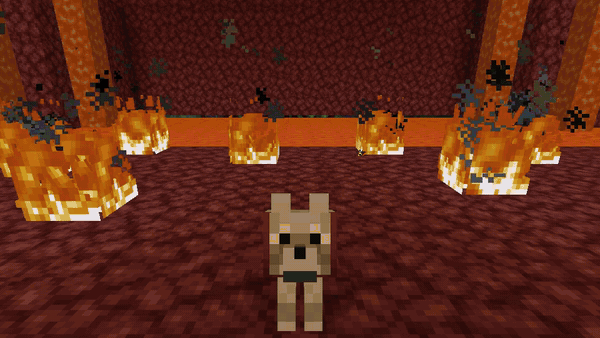
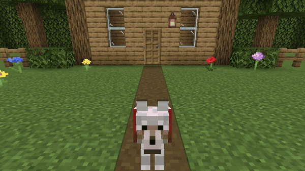
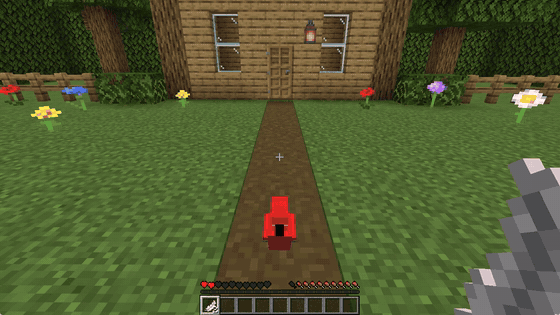
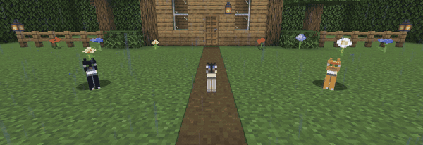
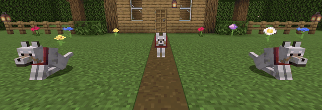
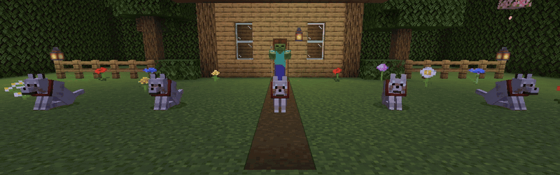
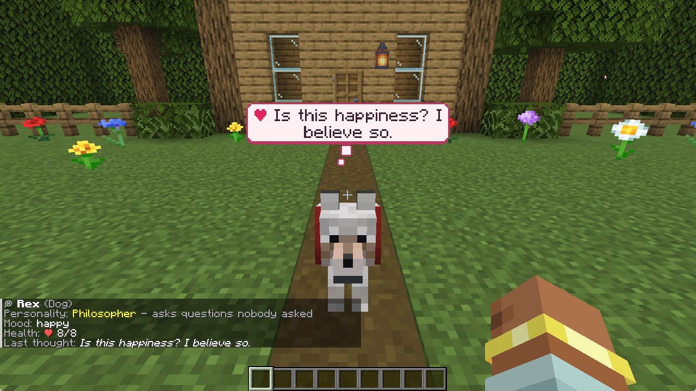

# 💭 Pet Thoughts

**Ever wondered what your dog is thinking? Now you know.**



Tamed pets show little thought bubbles that react to what happens around them, and every pet gets its own personality. Available as a **Paper plugin** (servers) and as a **Fabric mod** (single player and Fabric servers).

> ✅ **No client mods required** for the plugin. The Fabric mod is server-side too: in single player you just install it, on a server your friends can join with a vanilla client.
>
> 🇪🇸 Disponible en español (`language: es`).

## ✨ Features

- 💭 Comic-style thought bubbles above **wolves, cats, parrots, horses, donkeys, mules and llamas**: a colour for each mood, a speech pointer and a shake when they are scared, a little pop when they appear
- 🎭 **5 personalities**: Loyal, Drama Queen, Grumpy, Philosopher, Glutton
- 🧠 Reacts to **40+ situations**: danger, low health, food, rain, the Nether, you coming home, fishing, explosions, music...
- ❤ **Pet your pets**: look at one and press **F** (swap hands) for hearts and a happy thought
- 🦜 Species-specific lines (parrots repeat things. Of course they do.)
- 🤫 **Never spammy**: cooldowns per pet, per trigger and per player, group reactions are limited, lines do not repeat
- 👀 Show bubbles to everyone or only to the owner, or hide them for yourself
- 🌍 English and Spanish included, **900+ lines per language**, every one editable · ⚡ Folia supported

| | |
|---|---|
|  |  |
|  |  |

## 🎭 Personalities

Every pet gets one when it is tamed (or the first time the plugin sees it). Example: a zombie shows up.



| Personality | Tone | What it thinks |
|---|---|---|
| **Loyal** | Protective, loving | ❗ *I'll protect you!* |
| **Drama Queen** | Everything is the end of the world | ❗ *THIS IS HOW IT ENDS.* |
| **Grumpy** | Complains, loves you anyway | ❗ *Ugh. Zombie. Again.* |
| **Philosopher** | Asks questions nobody asked | ❗ *Is the Zombie also someone's pet?* |
| **Glutton** | Food. Only food | ❗ *Does it taste like chicken?* |



## 📦 Which file do I need?

| You have... | Download | Put it in |
|---|---|---|
| A **Paper / Purpur / Folia** server (1.21.4 – 26.x) | `PetThoughts-x.y.z.jar` | `plugins/` |
| **Single player** or a **Fabric** server (26.3) | `pet-thoughts-fabric-x.y.z.jar` + [Fabric API](https://modrinth.com/mod/fabric-api) | `mods/` |

Both do exactly the same: they share the same brain, lines and config.

## ⌨ Commands & permissions

Alias: `/pt`.

| Command | Permission (plugin) | Default | What it does |
|---|---|---|---|
| `/petthoughts info` | `petthoughts.info` | everyone | Personality, mood and last thought of the pet you look at |
| `/petthoughts toggle` | `petthoughts.toggle` | everyone | Hide / show thought bubbles for yourself |
| `/petthoughts mute` | `petthoughts.mute` | everyone | Silence one of your pets (or let it talk again) |
| *(press F looking at your pet)* | `petthoughts.pet` | everyone | Pet it |
| `/petthoughts set <personality>` | `petthoughts.admin` | op | Change the personality of the pet you look at |
| `/petthoughts test <trigger>` | `petthoughts.admin` | op | Force a thought |
| `/petthoughts reload` | `petthoughts.admin` | op | Reload config and language |

On Fabric there is no permission plugin: player features are open to everyone, admin commands need operator level 2 (or being the host of a single-player world).

## ⚙ Configuration

`plugins/PetThoughts/config.yml` (plugin) or `config/petthoughts/config.yml` (mod):

```yaml
language: en               # en | es | your own lang/xx.yml
visibility: all            # all | owner
frequency: 1.0             # 0.5 = half as chatty, 2.0 = twice as chatty
display-seconds: 4
min-interval: 30           # quiet time after a thought (seconds)
max-interval: 75
idle-chance: 0.12
max-bubbles-per-player: 3
owner-min-gap: 4           # seconds between ambient bubbles around one player
max-same-reaction: 2       # pets that comment on the same thing at once
petting:
  enabled: true
  swap-key: true           # look at your pet + F
  sneak-click: true        # sneak + right click with an empty hand
  hearts: true
bubble-style:
  line-width: 150          # long thoughts wrap after this many pixels
  tail: true               # thought dots (speech pointer for danger)
  animation: true          # pop in, float, shake when scared
  colors:                  # fill / outline / text for thought, love, food, danger
    thought: { fill: "#FFFFFF", outline: "#3B3347", text: "#2B2533" }
disabled-triggers: []
disabled-worlds: []
```

Every line the pets say lives in `lang/en.yml` / `lang/es.yml`. Add, change or delete as many as you like and run `/pt reload`. Bubble lines support colours (`<red>`, `<#FF8800>`), `<bold>` and `<italic>`.

## 🧩 Compatibility

- **Plugin:** Paper, Purpur and Folia, 1.21.4 to 26.x (Java 21+). No dependencies.
- **Mod:** Fabric 26.3 (Java 25) + Fabric API. Works with vanilla clients.
- Bubbles are built from vanilla Text Displays (one for the text, a few for the frame and tail): no resource pack, no client mod.

## 🛠 Building

```bash
./gradlew build
```

Needs JDK 25. Output: `paper/build/libs/PetThoughts-*.jar` and `fabric/build/libs/pet-thoughts-fabric-*.jar`.

```
common/   platform-independent brain: triggers, anti-spam, config, language files
paper/    Paper/Folia plugin (Bukkit events -> common)
fabric/   Fabric mod (Fabric events + mixins -> common)
```

## 💬 Support

Found a bug or want a new line or species? Open an issue on GitHub.

MIT License.
